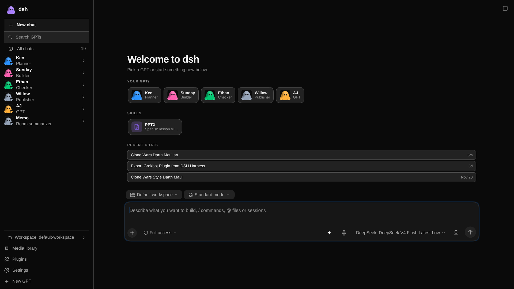
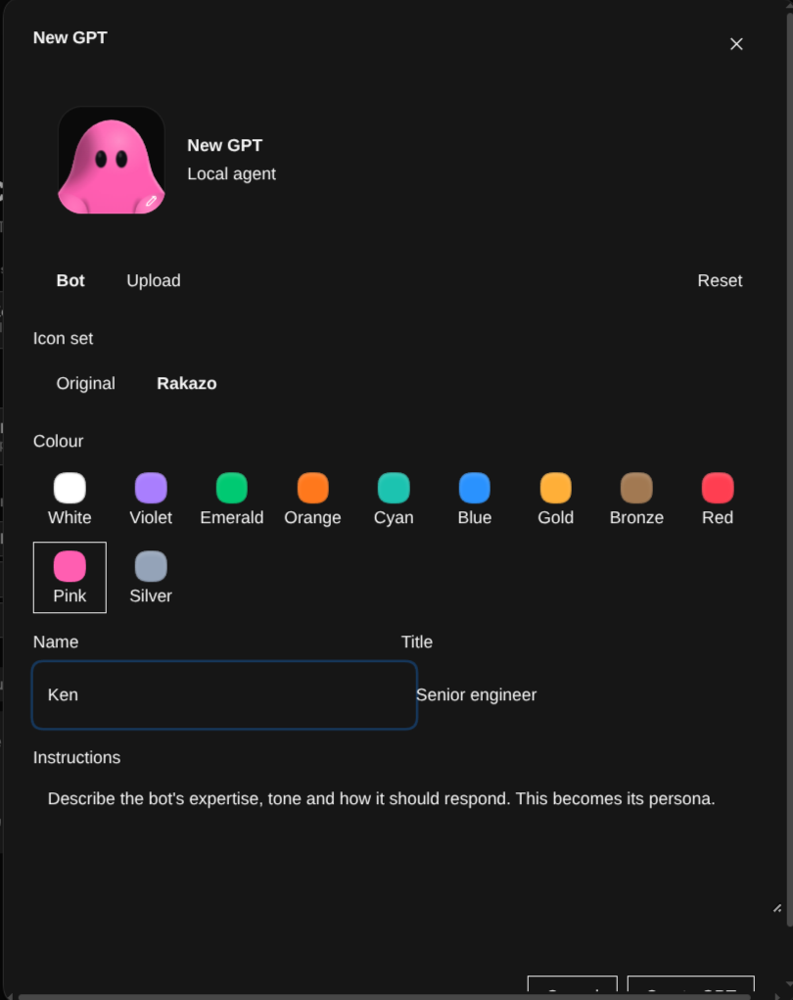
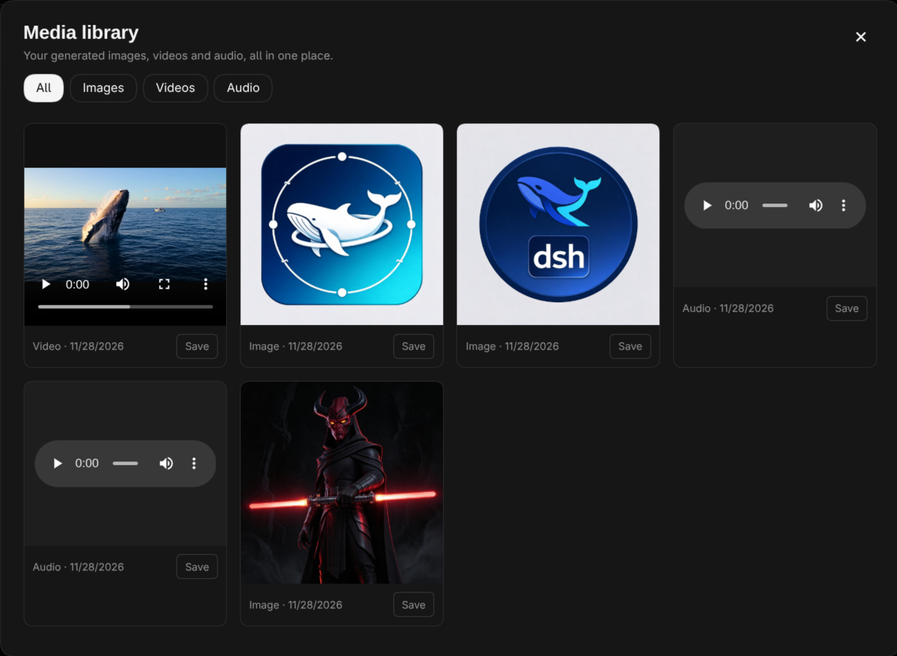

# Custom DSH for Omarchy and macOS

A custom interface and plugin collection for [DeepSeek Harness](https://github.com/deepseek-ai/deepseek-harness), with GPTs, a media library, image and video generation, speech generation, dictation, and optional OpenUI integration. This is a source release: it is not a standalone application or a packaged Mac app.

## Releases and support

- **Omarchy:** `v1.0.0-omarchy` — the web profile and plugins were tested on the author's Omarchy machine with DSH `0.2.2-rc.1`. An existing Omarchy desktop launcher can continue to open the web profile.
- **macOS:** `v1.0.0-macos` — the same plugin collection with macOS path compatibility. The web installation below has **not** been tested on a clean Mac. It is a preview, not a ready-to-install `.app`.

The `desktop/` Electron wrapper is the original Mac snapshot. It expects a separately prepared `~/Applications/DeepSeek Harness Runtime`; the runtime and a packaged app are not included. macOS-native dictation requires that original wrapper and is not available when using the web interface alone. Grok dictation uses OpenRouter.

## UI

### New Chat Interface


### Create GPT Interface


### Media Library Interface


## Requirements

- Node.js **24.9 or newer**, npm, Git and pnpm. DSH `0.2.2-rc.1` and pnpm `12.15.0` were used for the Omarchy test. Other DSH versions, including the Mac snapshot's `0.2.2-rc.5`, have not been verified with this release.
- Install the tested DSH version if it is not already available: `npm install -g @deepseek-ai/dsh@0.2.2-rc.1` (use a Node version manager if global installation requires elevated access). Install pnpm according to [pnpm's instructions](https://pnpm.io/installation).
- An OpenRouter API key is needed for media generation and Grok dictation. Configure `OPENROUTER_API_KEY` in DSH under **Settings → Models**. Requests and uploaded media go to OpenRouter and the selected providers; some features incur charges.

## Installation

The commands are the same on Omarchy and macOS. Use a terminal and keep the checkout in a permanent location: the DSH profile links directly to these files, and moving or deleting the folder will break the links.

1. Back up your existing profile **and any existing custom plugin data** before replacing a plugin with the same name. The following backs up the profile if it exists; manually copy any separately stored plugin folders and generated media as well:

   ```sh
   mkdir -p "$HOME/dsh-backups"
   if [ -d "$HOME/.dsh/profiles/web" ]; then
     cp -a "$HOME/.dsh/profiles/web" "$HOME/dsh-backups/web-$(date +%Y%m%d-%H%M%S)"
   fi
   ```

   If you use a custom `DSH_HOME`, back up its `profiles/web` directory instead. Your DSH credentials, chats, GPTs and media are not included in this repository or migrated automatically.

2. Clone the appropriate release (choose **one**):

   ```sh
   # Omarchy
   git clone --branch v1.0.0-omarchy https://github.com/petersillojoseph-jpg/dsh.git dsh-custom
   # macOS: use this command instead of the Omarchy command
   # git clone --branch v1.0.0-macos https://github.com/petersillojoseph-jpg/dsh.git dsh-custom
   cd dsh-custom
   ```

3. Install the plugins' dependencies and link them into the DSH web profile:

   ```sh
   npm ci --prefix plugins/grokbot-ui --ignore-scripts
   npm ci --prefix plugins/image-generation --ignore-scripts
   npm ci --prefix plugins/video-generation --ignore-scripts
   npm ci --prefix plugins/speech-generation --ignore-scripts
   dsh plugin --profile web add \
     "link:$PWD/plugins/grokbot-ui" \
     "link:$PWD/plugins/image-generation" \
     "link:$PWD/plugins/video-generation" \
     "link:$PWD/plugins/speech-generation" \
     "link:$PWD/plugins/openui"
   ```

   To leave out OpenUI, omit its final line and remove the trailing backslash from the preceding line. If another `@local/grokbot-ui` is already installed, this switches the profile to the new checkout; its old GPT data stays in its old plugin folder. Copy the old `data/` folder into `plugins/grokbot-ui/data/` only after making a backup and checking the destination does not already contain data to keep. Generated media is stored in the generation plugins' `data/` folders.

4. Restart any existing DSH web server, then run:

   ```sh
   dsh web
   ```

   Open the local URL printed by DSH if a browser does not open automatically. Omarchy users who already have a desktop launcher should restart its background DSH service, then reopen or refresh the app. The macOS web interface runs in a browser.

## Files and tests

`plugins/` contains the interface and generation integrations; `desktop/` contains the original Mac wrapper; `branding/` contains the Mac icon; `demo/` is reserved for future demo material. Credentials, profiles, GPT data and generated media are excluded from Git.

Run the local mocked tests with `node --test tests/*.test.mjs`. They do not make real generation requests or verify a Mac installation. The bundled client files are distributed alongside their editable sources; the original Grokbot build script was not included in the Mac snapshot. See `plugins/grokbot-ui/LICENSES/` and `THIRD_PARTY_NOTICES.md` for third-party notices. No additional licence is granted for the remaining code.
 
